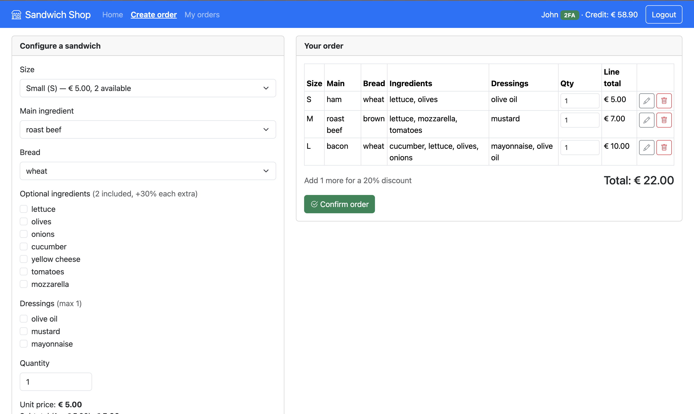
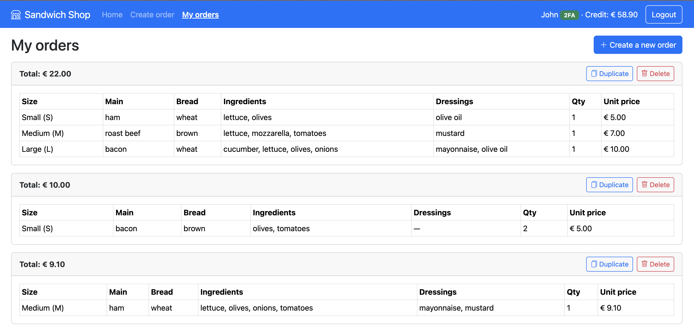

# Exam #2: "Sandwich"
## Student: s362034 BARTOLINI RICCARDO

## React Client Application Routes

- Route `/`: public home page. Shows the current availability of the three sizes and the full menu (main ingredients, breads, optional ingredients, dressings). Browsable by anyone; logged-in users also get a link to the configurator.
- Route `/login`: login form (pre-filled to speed up testing). After a successful login the optional two-factor (TOTP) step is offered, with a "Skip" button since 2FA is only required to delete orders.
- Route `/configurator`: order creation page (authenticated). Builds the order as a list of sandwiches; price and availability update in real time; sandwiches can be added, edited, removed and their quantity changed, then the order is confirmed.
- Route `/orders`: order management area (authenticated). Lists the user's confirmed orders with all details; each order can be duplicated into a new draft (loaded into the configurator) or deleted (deletion requires 2FA).
- Route `*`: not-found page with a link back to the home.

## API Server

- POST `/api/sessions`: log in.
  - request body: `{ "username": "u1@p.it", "password": "pwd" }`
  - response body: user info `{ id, username, name, credit, canDoTotp, isTotp }`; 401 on wrong credentials.
- POST `/api/login-totp`: verify the second factor on the current session.
  - request body: `{ "code": "123456" }` (6 digits)
  - response body: `{ "otp": "authorized" }`; 401 on wrong/replayed code.
- GET `/api/sessions/current`: current logged-in user.
  - response body: user info `{ id, username, name, credit, canDoTotp, isTotp }`; 401 if not authenticated.
- DELETE `/api/sessions/current`: log out.
  - response body: `{}`
- GET `/api/sizes`: sizes with prices, limits and current availability (public).
  - response body: `[{ size, basePrice, includedIngredients, maxDressings, dailyMax, available }]`
- GET `/api/menu`: available choices for building a sandwich (public).
  - response body: `{ mains:[...], breads:[...], ingredients:[...], dressings:[...] }`
- GET `/api/orders`: the confirmed orders of the authenticated user, with full details.
  - response body: `[{ id, total, sandwiches:[{ id, size, mainIngredient, bread, quantity, unitPrice, ingredients:[...], dressings:[...] }] }]`
- POST `/api/orders`: confirm a new order (created atomically). The server re-validates every field against the catalog and recomputes price, availability and credit; client-sent prices are ignored.
  - request body: `{ sandwiches:[{ size, mainIngredient, bread, quantity, ingredients:[...], dressings:[...] }] }`
  - response body: `{ order:{...}, credit }`; 422 on invalid data or insufficient credit, 409 when availability is exceeded (e.g. "Not enough L sandwiches available").
- DELETE `/api/orders/:id`: delete one of the user's own orders (requires 2FA). Restores availability and refunds 90% of the paid amount.
  - request parameter: `id` (order id)
  - response body: `{ orderId, refund, credit }`; 401 without 2FA, 404 if the order does not belong to the user.

## Database Tables

- Table `users`: application users. Columns: `id` (PK), `email` (unique, used as username), `name`, `hash`, `salt`, `secret` (per-user TOTP secret), `lastTotpStep` (TOTP replay protection), `credit`.
- Table `sizes`: sandwich sizes with their configuration. Columns: `size` (PK, 'S'/'M'/'L'), `base_price`, `included_ingredients`, `max_dressings`, `daily_max`.
- Table `main_ingredients`: available main ingredients. Column: `name` (PK).
- Table `breads`: available bread types. Column: `name` (PK).
- Table `ingredients`: available optional ingredients. Column: `name` (PK).
- Table `dressings`: available dressings. Column: `name` (PK).
- Table `orders`: confirmed orders. Columns: `id` (PK), `userId` (FK → users), `total`.
- Table `order_sandwiches`: the configured sandwiches of an order. Columns: `id` (PK), `orderId` (FK → orders), `size`, `main_ingredient`, `bread`, `quantity`, `unit_price`.
- Table `sandwich_ingredients`: optional ingredients chosen for a sandwich. Columns: `sandwichId` (FK → order_sandwiches), `ingredient` (PK: sandwichId + ingredient).
- Table `sandwich_dressings`: dressings chosen for a sandwich. Columns: `sandwichId` (FK → order_sandwiches), `dressing` (PK: sandwichId + dressing).

Availability is not stored: it is always derived as `daily_max` minus the quantities in confirmed orders, so it stays correct with multiple clients.

## Main React Components

- `App` (in `App.jsx`): top-level component; holds authentication state and the order being configured (cart), defines the handlers and the routes.
- `Navigation` (in `Navigation.jsx`): navigation bar with the page links, the logged-in user with credit and 2FA badge, and the login/logout button.
- `SizeAvailability` and `MenuOverview` (in `Catalog.jsx`): public cards showing size availability/prices and the menu of choices.
- `Configurator` (in `Configurator.jsx`): the sandwich builder and the current order (cart), with real-time price computation and per-add availability checks.
- `Orders` (in `Orders.jsx`): the order management area (list, duplicate, delete).
- `LoginForm` and `TotpForm` (in `Auth.jsx`): the login form and the optional two-factor form.
- `Layout` (in `Layout.jsx`): the shared page shell (navigation + feedback messages) and the per-route layouts.
- `API` (in `API.js`): module with all the calls to the HTTP APIs.

## Screenshot

## Users Credentials

All users are regular customers; every user can enable two-factor authentication (TOTP) at login (the shared TOTP secret is the one provided in the exam text). Two-factor is required only to delete orders.

- `u1@p.it`, password `pwd` — has 3 preloaded confirmed orders (one with sandwiches of different sizes).
- `u2@p.it`, password `pwd` — has 3 preloaded confirmed orders (one with multiple units of the same sandwich).
- `u3@p.it`, password `pwd` — no preloaded orders (credit 100).
- `u4@p.it`, password `pwd` — no preloaded orders (credit 100).
