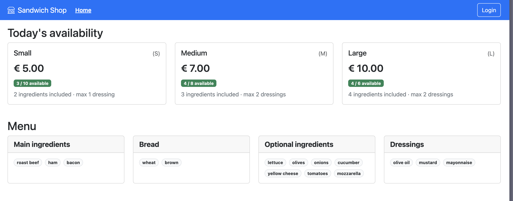

# Sandwich Ordering App

**A React, Express and SQLite coursework application exploring authentication, authorization and server-side validation.**


[](LICENSE)

Users can configure sandwiches, place orders and manage their own orders. The server validates the order contents, computes prices and checks credit and availability before accepting an order.



## Features

- Browse sandwich sizes, ingredients, prices and availability.
- Sign in and view orders belonging to the authenticated user.
- Configure sandwiches and submit orders with server-computed prices.
- Complete a TOTP verification step to enable order deletion in the session.
- Cancel an owned order and receive the configured partial refund.

## Security implementation

| Area | Implementation |
| :--- | :--- |
| Password verification | Salted `scrypt` hashes and a timing-safe comparison. |
| Authentication | Passport local authentication and server-side sessions. |
| Authorization | Order queries and mutations are scoped to the authenticated user's ID. |
| Database access | Parameterized SQLite statements for user-controlled values. |
| Input validation | Server-side checks for quantities, catalogue values, duplicate ingredients and size constraints. |
| TOTP | A session verification step with a stored last-used time step intended to reject reused codes. |
| Concurrent order requests | An in-process promise mutex serializes order operations within one server instance. |

This is an educational application. The implementation has not undergone an independent security audit; the scope and remaining limitations are documented below.

## Run locally

Use Node.js and npm. Install the client and server dependencies separately using the included lockfiles.

```bash
git clone https://github.com/Riccardo-Bartolini/Sandwich-Ordering-App.git
cd Sandwich-Ordering-App
```

**Terminal 1 — API**

```bash
cd server
npm ci
node index.mjs
```

The API listens on `http://localhost:3001`. Run it from `server/` so that the relative database path resolves correctly.

**Terminal 2 — interface**, starting from the repository root:

```bash
cd client
npm ci
npm run dev
```

Open `http://localhost:5173`. The server's development CORS configuration allows this exact origin; if Vite selects a different port, stop the process using port 5173 or update the development configuration consistently.

### Demo data

The seeded database and `server/init-db.mjs` contain local demonstration users, including `u1@p.it` and `u2@p.it`, with password `pwd`. These are synthetic demo credentials and must not be reused elsewhere. TOTP configuration is also demonstration data.

To reset the database, stop the API, back up any data you want to keep, then run the following **inside `server/`**:

```bash
node init-db.mjs
```

This replaces the database with its initial demo state. Restart the API afterwards.

## Architecture

```text
React client → Express routes → authentication / validation → data access objects → SQLite
```

| Path | Purpose |
| :--- | :--- |
| [`client/`](client/) | React interface, routing and API requests. |
| [`server/index.mjs`](server/index.mjs) | HTTP routes, session authentication, TOTP and order validation. |
| [`server/dao-users.mjs`](server/dao-users.mjs) | User lookup, password verification, credit and TOTP state. |
| [`server/dao-orders.mjs`](server/dao-orders.mjs) | User-scoped order queries and updates. |
| [`server/init-db.mjs`](server/init-db.mjs) | Demo schema and seed data. |
| [`img/`](img/) | Additional application screenshots. |

## Development checks

```bash
cd client
npm run build
npm run lint
```

These are the configured client checks. The server does not currently include an automated test suite; its `npm test` script is a placeholder. Passing a client build would not establish the security of the API.

## Scope and next improvements

- Replace the hard-coded session secret, configure production cookies and use an appropriate session store before deployment.
- Add explicit CSRF protection, security headers and authentication rate limiting.
- Make TOTP time-step consumption atomic and define how long session verification remains valid. Currently it enables deletion for the session rather than requiring a fresh code for each deletion.
- Wrap related order and credit writes in database transactions. The in-process mutex does not provide rollback or coordination between multiple server processes.
- Add API regression tests for cross-user access, invalid inputs, concurrent orders, TOTP replay and session lifecycle behavior.

## Author and license

Developed by **Riccardo Bartolini** as university coursework at **Politecnico di Torino**.

Project code is available under the [MIT License](LICENSE). Dependencies retain their respective licenses.
